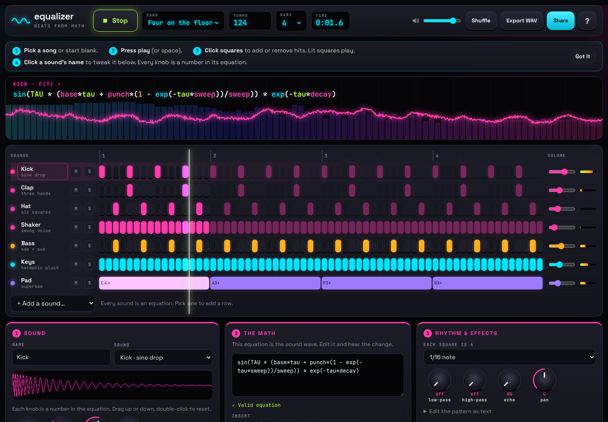

# equalizer

**Beats from math.** Every drum, bass line and melody is an equation you can read, tweak and share.

```
kick  = sin(TAU * (base*tau + punch*(1 - exp(-tau*sweep))/sweep)) * exp(-tau*decay)
pluck = (sin(TAU*f*tau) + bright*sin(TAU*2*f*tau)) * exp(-tau*decay)
hat   = noise() * exp(-tau*55)
```



**Open the studio:** https://ghanemja.github.io/equalizer/

The studio looks like a DJ console, but every sound is just an equation. Each sound gets a row in the step grid: light up squares to make it play. Click a sound to open its panel, where the knobs are the numbers in its equation and you can edit the math itself. The math monitor on the right plots every sound's equation on graph paper, live: each time a sound fires, a playhead sweeps along its curve. At the top, the equation lab lets you paste any equation, hear it, see its plot, and add it to the beat in one click. Share any beat as a link.

No samples, no dependencies, no build step. Every sound is computed from math, 44,100 times a second.

## Listen

- [Hyperbolic 808](docs/audio/hyperbolic-808.mp3): the studio's default beat (trap, 140 bpm)
- [Floor Function](docs/audio/four-on-the-floor.mp3): four on the floor (house, 124 bpm, 16 bars)
- [art-medium theme](docs/audio/art-medium-theme.mp3): the soundtrack of the art-medium promo video

All three were rendered straight from their equations with `examples/render.mjs`, then encoded to MP3.

## Live feed

Hit **Post your beat** in the studio and it shows up for everyone in the live feed, where anyone can play it, like it and remix it. The feed runs on a free [Supabase](https://supabase.com) database: `feed.js` talks to it directly (REST plus a websocket for live updates, falling back to checking every 30 seconds), and `supabase/schema.sql` sets it up. Visitors can only read, post, like and report; nobody can edit or delete from a browser, each visitor can post 5 beats per 10 minutes, and 3 reports hide a beat. If the feed is down, the rest of the studio keeps working.

To run your own copy, create a Supabase project, run `supabase/schema.sql` in its SQL Editor, and put your project URL and publishable key at the top of `feed.js`.

## How it works

A song is a tempo plus a list of tracks. Each track is an equation, a step pattern that says when it fires, and its parameters:

```js
import { renderSong, toWav, Player } from 'equalizer';

const song = {
  bpm: 120,
  bars: 4,
  tracks: [
    {
      name: 'Kick',
      equation: 'sin(TAU * (base*tau + punch*(1 - exp(-tau*sweep))/sweep)) * exp(-tau*decay)',
      params: { base: 48, punch: 160, sweep: 28, decay: 7 },
      pattern: 'x...x...x...x...',
    },
    {
      name: 'Bass',
      equation: 'saw(f*tau) * exp(-tau*3)',
      pattern: 'C2 . . . C2 . Eb2 . F2 . . . G2 . . .',
      lp: 600,
    },
  ],
};

// In the browser: play it, and hot-swap changes without stopping
const player = new Player();
await player.play(song);       // after a click
player.update(changedSong);

// Anywhere, including Node: render to audio or a WAV file
const { left, right, sampleRate } = renderSong(song);
const wav = toWav(left, right, sampleRate);
```

### Variables

| Name | Meaning |
| --- | --- |
| `t` | seconds since the song started |
| `tau` | seconds since this note started (use it for envelopes) |
| `f` | the note's frequency in Hz |
| `beat`, `bar`, `step` | position in the song |
| `r` | a random number per note, for humanizing |
| `bpm` | the tempo |

Plus any parameters you define (`decay`, `punch`, …), which become knobs in the studio.

### Functions

`sin cos tan tanh exp log pow sqrt abs min max floor fract mod clamp mix`, oscillators that take a phase in cycles (`osc`, `saw`, `sqr(p, duty)`, `tri`), `noise()`, an envelope `ad(tau, attack, decay)`, and constants `PI TAU E`. `a ^ b` is a power and `cond ? a : b` picks between two values.

### Paste math the way you write it

The studio reads everyday math too: `2πft`, `e^{-3t}`, `x²`, `|x|`, `√x`, LaTeX like `\sin` and `\frac{a}{b}`, and `y =` or `f(t) =` in front. It shows what it read (`y = e^{-3t} \sin(2\pi f t)` becomes `E^(-3*tau)*sin(2*PI*f*tau)`). A pasted formula's `x` or `t` is read as `tau`, the time since the note started. In code:

```js
import { readMath } from 'equalizer/math';
readMath('sin(2πft)·e^(−4x)').equation;   // 'sin(2*PI*f*tau)*E^(-4*tau)'
```

### Patterns

- Drums: `x...x...` (`x` fires, `.` lets it ring, `-` stops it, `|` is ignored so you can write `x...|x...`).
- Notes: `C3 . E3 . G3+B3 -` (notes, or chords joined with `+`).
- `rate` is steps per beat (4 = sixteenth notes, 0.25 = one per bar).
- Songs take `beatsPerBar` (the time signature: 4 by default, 3 for a waltz, 5 or 7 for odd time). The studio also has **Squares per beat** (1, 2, 3 for triplets, 4, 6 or 8) for the grid; changing it moves every hit to the nearest square so the beat stays put.
- `at: [1.5, 3.2]` fires at exact times in seconds, handy for sound effects.
- `gate: 't > 8 && bar < 12'` is an equation that decides whether a step fires. Use it for arrangement: drop the drums out, bring them back.

### Math rhythms

Instead of clicking squares, pick a rhythm in a sound's panel (Rhythm & effects → Math rhythm), or use the generators directly:

| Rhythm | What it does |
| --- | --- |
| Euclidean E(k, n) | k hits spread as evenly as possible over n steps. E(3,8) is the tresillo, E(5,16) a bossa feel, E(7,16) samba |
| Polyrhythm a : b | a evenly spaced pulses against b |
| Fibonacci steps | Hits on steps 1, 2, 3, 5, 8, 13 |
| Prime steps | Hits on steps 2, 3, 5, 7, 11, 13 |
| Golden ratio | Hits wherever multiples of 1/φ cross a whole number (the Fibonacci word) |
| Your own rule | Hit wherever an equation is true, like `i % 3 == 0` (i is the step, n the number of steps) |

Every one can be rotated, and melodic sounds keep their notes on the new hits.

```js
import { makeRhythm, toPattern } from 'equalizer/rhythms';
toPattern(makeRhythm('euclid', { k: 3, n: 8 }));   // 'x..x..x.'
```

### Track options

`gain`, `pan` (−1 to 1), `lp` and `hp` (one-pole filters in Hz), `echo` (feedback 0–0.9) with `echoTime` in beats, `len` (max note length in seconds), `mute`, `solo`. Songs take `bpm`, `bars` or `duration`, `master`, `fadeIn` and `fadeOut`.

## Safe to share

Songs travel as links, so equations are never run as JavaScript. A small parser accepts only numbers, math operators and the whitelisted names above, and rejects everything else (`constructor`, property access, strings, assignments and so on). The test suite includes those attacks.

## Render from the command line

```sh
node examples/render.mjs house house.wav        # a built-in song
node examples/render.mjs ./my-song.js out.wav   # a module that default-exports a song
```

## Built-in songs

Each one is named after the math behind its signature sound.

| Song | Style | The math |
| --- | --- | --- |
| Hyperbolic 808 (default) | Trap, 140 bpm | The 808 kick is `tanh(drive * sin(...))`, a sine pushed through the hyperbolic tangent |
| Floor Function | House, 124 bpm | Four on the floor. It's also the theme of the art-medium promo video |
| Fourier Drive | Synthwave, 100 bpm | Sawtooth bass and pads; every saw is a Fourier series of sines |
| Sine of the Times | Dubstep, 140 bpm | The wobble is a saw multiplied by a slow sine |
| Trig Homework | Lo-fi, 84 bpm | A triangle wave with a slow sine wobble on its pitch |
| Square One | Chiptune, 140 bpm | Square waves, `sqr(f*tau, duty)` |

Pick one from the Song menu, or render it with `node examples/render.mjs <id>` (`trap`, `house`, `synthwave`, `dubstep`, `lofi`, `chip`).

## Develop

```sh
npm test       # node's built-in test runner, no dependencies
npm start      # serve the studio at http://localhost:8080
```

`src/equalizer.js` is the library, `src/presets.js` holds the built-in equations and songs, `src/mathinput.js` reads everyday math, `src/rhythms.js` makes math rhythms, `index.html`, `studio.css` and `studio.js` are the studio, and `feed.js` is the live feed.

## Made with equalizer

The soundtrack of the [art-medium](https://github.com/ghanemja/art-asset) promo video was written with equalizer: every note and sound effect is an equation.

## License

MIT. See [LICENSE](LICENSE).
